# Triple-Screen

基于 *Alexander Elder* 博士在 *The New Trading for a Living* 一书中所教授的 *Triple Screen* 系统所开发的股票波段交易分析程序。

参考 *Van K. Tharp* 博士在 *Trade Your Way to Financial Freedom 2nd Edition* 一书中所强调的 *Reward to Risk Ratio* 的概念添加了相关工具。

注意，所谓 *Triple Screen* 并非像海龟交易法则一样使用明确且固定的指标参数和入场出场规则。

它更多的指的是一种思路，重点在于使用多个周期的价格数据进行分析。

在指标参数、入场信号和止损止盈方法的使用方面，在书中也都提供了多种不同的选择。

该分析程序所应用的交易策略，并非书中典型策略的原样复刻，而是根据我自己的理解和需求进行了一点点变更。

交易策略的收益效果并未经过严格测试，不构成投资建议。

## 典型的三种使用方法：

一、程序将读取 **_watchlist.toml** 中预定义的股票列表，下载它们的 OHLCV 数据，计算指标，输出交易信号。
```bash
python main.py
```
二、程序将读取指定市场（支持 A 股，港股，美股）的指定指数的成分股列表，下载它们的 OHLCV 数据，计算指标，输出交易信号。
```bash
python main.py Index A 000510

python main.py Index HK HSI

python main.py Index US SPX
```
三、程序将读取指定配置文件中的股票列表，下载它们的 OHLCV 数据，计算指标，输出交易信号。
```bash
python main.py A-ETF.toml

python main.py US-ETF.toml
```
使用上述任意一种方法执行程序之后，将会自动生成 **charts** **data** **signals** 三个目录，并在它们各自的子目录中分别生成 HTML 图表 & CSV 数据文件 & Markdown 交易信号文件。

效果如下图所示：

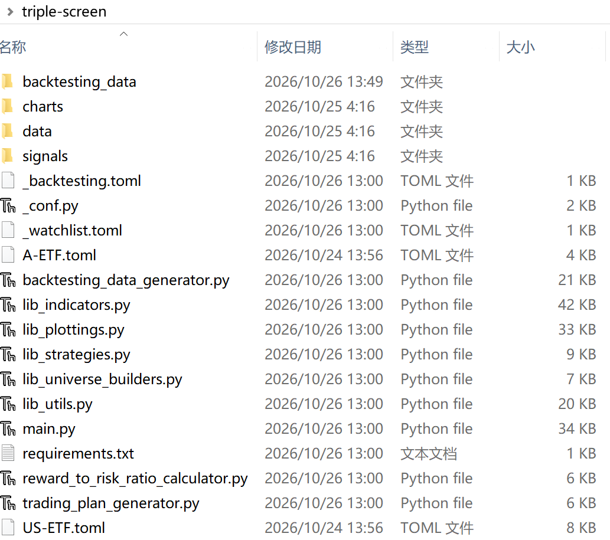

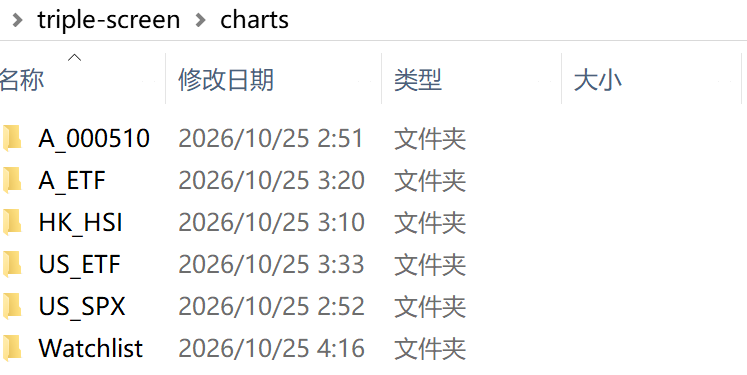

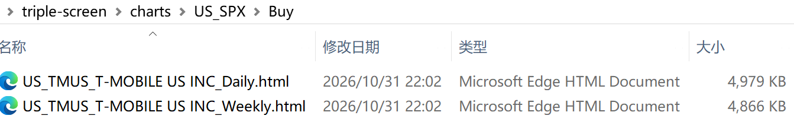

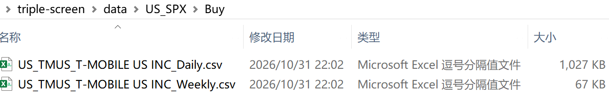

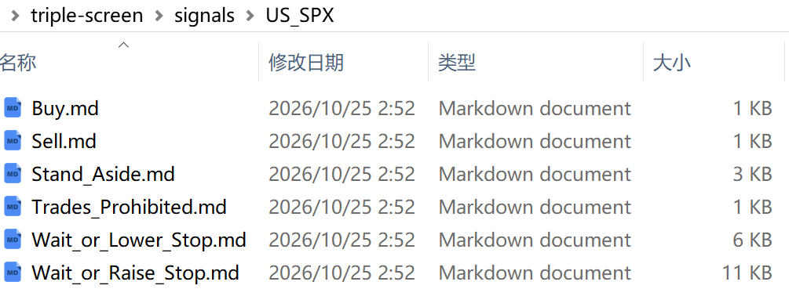

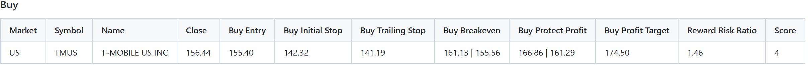

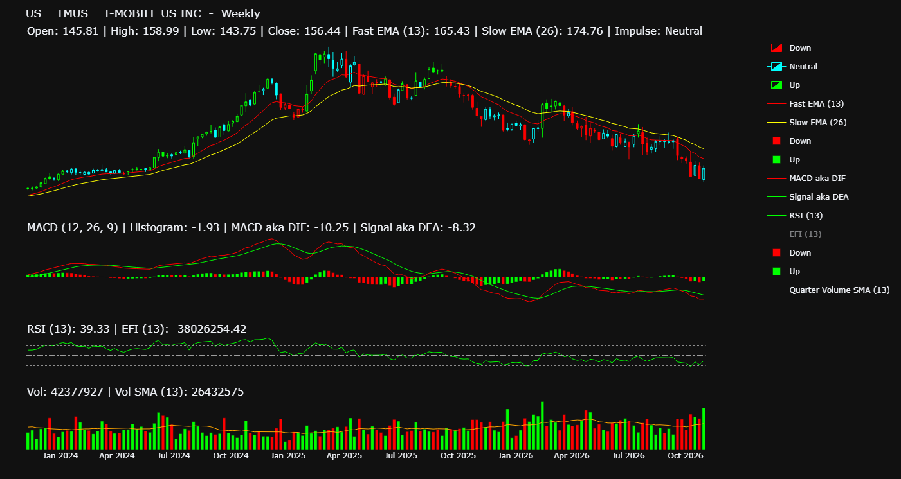

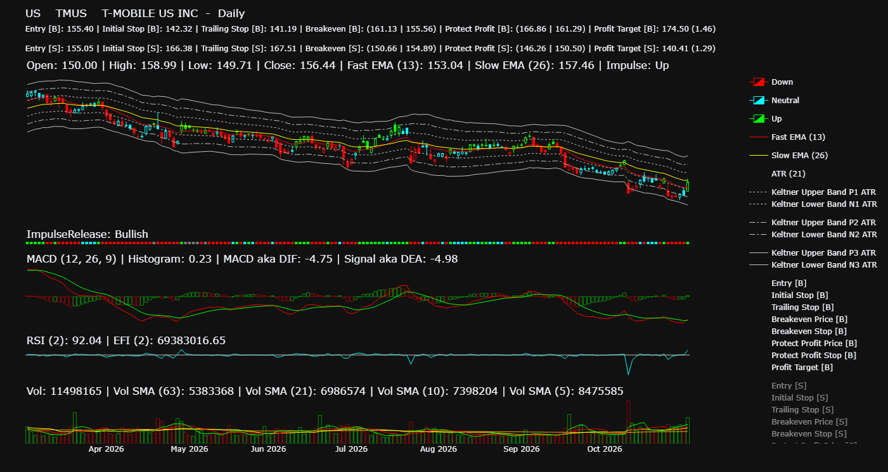

## 生成供回测使用的数据：

一、程序将读取 **_backtesting.toml** 中预定义的股票列表，下载它们的 OHLCV 数据，计算指标，输出供回测使用的 csv 数据文件。
```bash
python backtesting_data_generator.py
```
二、程序将读取指定配置文件中的股票列表，下载它们的 OHLCV 数据，计算指标，输出供回测使用的 csv 数据文件。
```bash
python backtesting_data_generator.py A-ETF.toml

python backtesting_data_generator.py US-ETF.toml
```
使用上述任意一种方法执行程序之后，将会自动生成 **backtesting_data** 目录，并在其子目录中分别为不同的股票市场生成供回测使用的 csv 数据文件。如果在一个市场中存在多只股票的话，还会另外生成一个将它们组合在一起的 csv 数据文件，供多标的回测使用。

效果如下图所示：

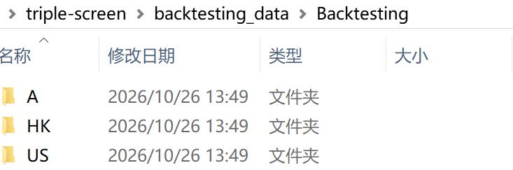

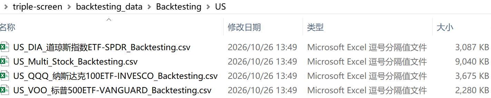

## 其他辅助工具：

一、这是一个交互式的工具，按照提示输入参数，计算收益风险比率。
```bash
python reward_to_risk_ratio_calculator.py
```
二、这是一个交互式的工具，按照提示输入参数，计算一笔交易不应逾越的最大数量。
```bash
python trading_plan_generator.py
```

## 主要指数 ETF 回测结果：

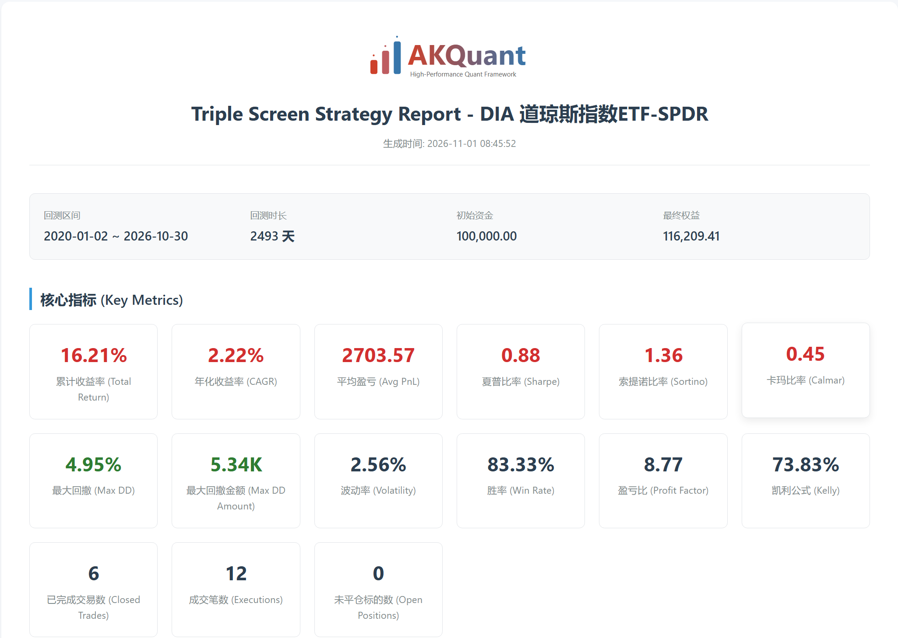

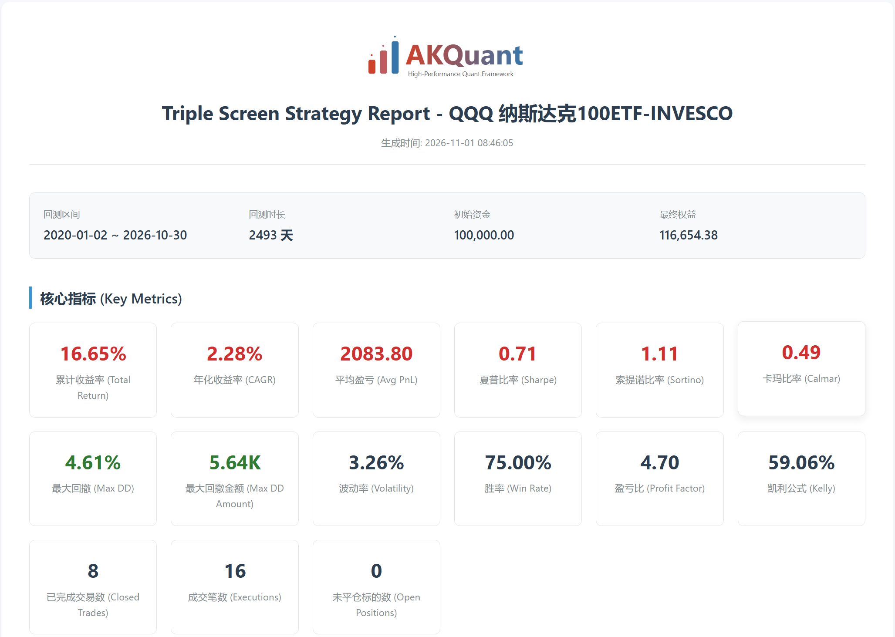

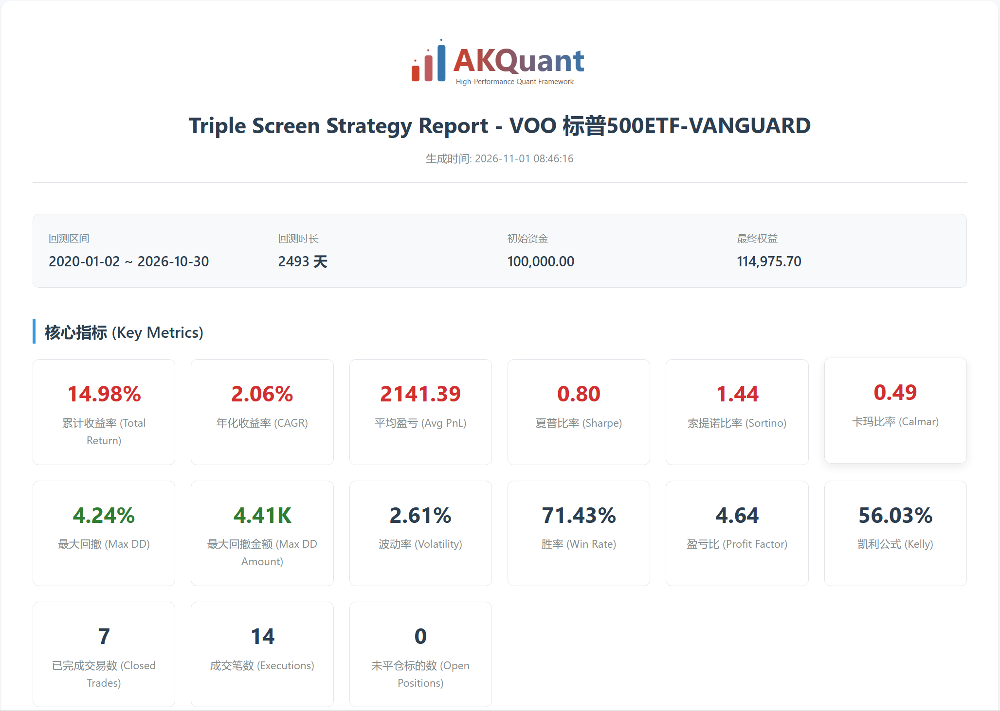

该回测结果仅供参考。
